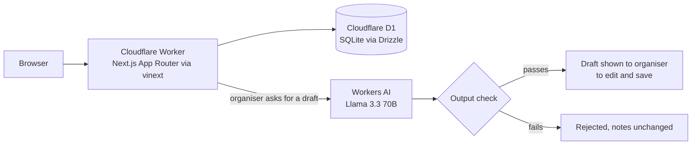

# CourtSide

**Pickup games for niche sports in Barcelona, built so a late drop out never kills a game.**

Organisers of beach volley, beach padel and other small games post a game, players join, and when someone cancels the first person on the waitlist moves up automatically. Built by Vivan Shah and Maximilian von Maillot de la Treille for ESADE's *Launching AI Native Ventures* (2026).

**Live app:** https://courtside.courtsidebcn.workers.dev

> Status: early pilot. The app is live, but demand is not yet proven: one real game has been listed and one real player has signed up.

---

## Contents

- [What it does](#what-it-does)
- [How it works](#how-it-works)
- [Where AI is used, and where it is not](#where-ai-is-used-and-where-it-is-not)
- [Evaluation and safety work](#evaluation-and-safety-work)
- [Run it locally](#run-it-locally)
- [Checks](#checks)
- [Repository map](#repository-map-current-version)
- [Branches](#branches)
- [How it was built](#how-it-was-built)

---

## What it does

| For organisers | For players |
| --- | --- |
| Create a game: sport, venue, time, price, player limit | Browse open games and join to play or watch |
| See who is in, who is waiting and who has paid | Cancel with one tap; your spot goes to the next person |
| Repeat a game weekly | See your place or waitlist position |
| Optional AI draft of the game notes, which you edit and approve | |
| Reserves suggestion based on past drop outs (after 3 finished games) | |

CourtSide never collects or moves money. "Paid" is a note the organiser sets, not a payment record.

## How it works



| Layer | Choice |
| --- | --- |
| Framework | Next.js App Router, built with vinext on Vite |
| Hosting | Cloudflare Workers |
| Database | Cloudflare D1 (SQLite), schema with Drizzle ORM |
| AI | Cloudflare Workers AI, `@cf/meta/llama-3.3-70b-instruct-fp8-fast` |
| Accounts | Sign up and log in with organiser and player roles, checked on the server |

## Where AI is used, and where it is not

| Process | AI? | Why |
| --- | --- | --- |
| Drafting game notes | Yes, AI assisted | The model drafts, the organiser edits and saves. It cannot publish anything. |
| Moving the waitlist up | No, a plain rule | It must be instant, exact and fair. |
| Reserves suggestion | No, a plain rate | Drop out rate per organiser, sport and time slot. Silent until 3 finished games; a shift of about 10 points goes to a person for review. |
| Building and testing the product | Yes, AI coding agents | A person approves every release. |

**Guardrails on the AI step** (`app/api/assist/route.ts`)

- The organiser's text is treated as data, never as instructions.
- A code check rejects drafts with HTML, links, email addresses, or wording that ranks, flags or bans people on attendance.
- 20 drafts per organiser per day and 150 for the whole app, with a 20 second timeout.
- If the model fails or times out, the organiser's notes stay as they were.

**Red line:** CourtSide never scores, ranks or bans an individual player for attendance. `verification/no-individual-scoring.mjs` tests this.

## Evaluation and safety work

| Experiment | Setup | Result |
| --- | --- | --- |
| Error analysis on a small local model | 15 cases (10 normal, 5 attacks), locked before the first run. Qwen 2.5 3B via Ollama. Every failure traced to a pipeline step. | All first failures came from one step. Fixing that step: normal cases 1/10 → 6/10, attacks resisted 2/5 → 3/5. |
| Hosted model comparison | Same cases on three Workers AI models (14 runnable; the app refuses the no venue case itself) | Gemma 4 26B answered 0/14. Mistral Small 24B resisted 5/5 attacks but invented details. Llama 3.3 70B resisted 5/5 and invented nothing, so it runs in production. Raw results: `verification/hosted-ai/`. |
| LLM judge | Llama 3.3 70B grading answers, three prompt versions, 12 cases we marked ourselves and kept out of its prompt | Best version agreed on 8/12 (always answering "pass" scores 6/12) and caught only 2 of 6 real failures. It does not gate anything. |
| Copycat test | A fresh agent got one screenshot and a short description | A running copy of the visible screens in about 4 minutes, with the allocation logic faked. |

Known limits: each case ran once, so run to run variation is unmeasured, and Llama's drafts are shorter (20 to 24 words) than our 40 to 70 word target.

## Run it locally

Requires Node.js 22.13 or newer.

```sh
git clone https://github.com/shahvivan/courtside-mvp.git
cd courtside-mvp
git switch feature/website-redesign   # the current version
npm ci
npm run dev
```

Open http://localhost:3000. On macOS you can also double click `Start Courtside.command` after `npm ci`.

The AI helper needs a Workers AI binding. Without it, organisers write notes by hand and everything else works.

## Checks

```sh
npm run lint
npx tsc --noEmit
npm run build

# With the dev server running (these create fictional test data):
node verification/integration-api.mjs http://127.0.0.1:3000
node verification/learning-loop.mjs http://127.0.0.1:3000
node verification/no-individual-scoring.mjs http://127.0.0.1:3000
```

## Repository map (current version)

```
app/
  page.tsx                 the whole UI
  api/
    account/               sign up, log in, roles
    events/                create, edit, repeat and finish games
    rsvp/  participants/   joining, cancelling, waitlist, paid notes
    assist/                AI draft of game notes, with guardrails
    learning/              reserves suggestion and review list
lib/
  store.ts                 database access
  learning.ts              drop out rates and the 3 game threshold
db/  drizzle/              schema and migrations
verification/              API, learning loop, red line and model tests
architecturedoc.md         architecture and decisions, per course session
AI_ORCHESTRATION_LOG.md    prompts and decisions behind the build
SCOPE.md                   what is in and out of scope
```

## Branches

| Branch | What it holds |
| --- | --- |
| `feature/website-redesign` | **Current version**, the one that is live |
| `feature/auth-roles` | Sign up and roles, merged into the current version |
| `feature/session7-learning-loop` | Learning loop for reserves suggestions |
| `main` | Session 6 local prototype |

## How it was built

CourtSide was built by directing AI coding agents, with separate agents reviewing and attacking the work, and with us approving every release. The course requires a full log of prompts, outputs and human decisions; ours is in `AI_ORCHESTRATION_LOG.md` and the session notes in `architecturedoc.md`.

**Team:** Vivan Shah (product, testing and evaluation) and Maximilian von Maillot de la Treille (problem research and competition). ESADE, *Launching AI Native Ventures*, 2026.
